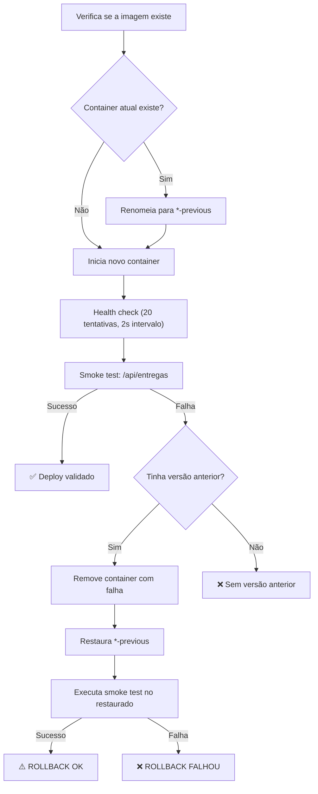

# CEUB — Laboratório de Entrega Contínua com .NET 10

## 1. Repositório

**Repositório:** https://github.com/danielzinrx/ceub-cd-dotnet10

Projeto acadêmico desenvolvido para praticar integração contínua (CI), entrega contínua (CD), Docker, GitHub Actions e implantação com validação e rollback.

---

## 2. Tecnologias utilizadas

| Tecnologia | Versão / Detalhe |
|---|---|
| .NET SDK | 10.0 |
| ASP.NET Core | Minimal API |
| xUnit | 2.9.3 |
| Docker | Imagem base `mcr.microsoft.com/dotnet/aspnet:10.0` |
| GitHub Actions | CI/CD com runners `ubuntu-latest` e `self-hosted` |
| Shell Script (Bash) | Script de deploy com rollback |

---

## 3. Estrutura do projeto

```
ceub-cd-dotnet10/
├── .github/workflows/
│   ├── ci-staging.yml            # Pipeline CI → Staging (automático)
│   └── promover-producao.yml     # Pipeline Promoção → Produção (manual)
├── scripts/
│   └── deploy.sh                 # Implantação, health check e rollback
├── src/Ceub.Api/
│   ├── Ceub.Api.csproj           # Projeto da API (.NET 10)
│   ├── Program.cs                # Endpoints da Minimal API
│   └── Catalogo.cs               # Modelo de domínio (Entrega + Catalogo)
├── tests/Ceub.Api.Tests/
│   ├── Ceub.Api.Tests.csproj     # Projeto de testes (xUnit)
│   └── CatalogoTests.cs          # Testes unitários do Catálogo
├── publish/                      # Saída do dotnet publish (usada pelo Docker)
├── Dockerfile                    # Construção da imagem da aplicação
├── .dockerignore                 # Restringe contexto do build Docker
├── Ceub.Delivery.slnx            # Solution do projeto
└── README.md                     # Este documento
```

---

## 4. API — Endpoints implementados

A aplicação é uma Minimal API ASP.NET Core com os seguintes endpoints:

| Método | Rota | Descrição |
|---|---|---|
| GET | `/` | Retorna informações da aplicação (versão, commit, ambiente) |
| GET | `/health` | Health check — retorna `200 OK` ou `503` se `FAIL_HEALTH=true` |
| GET | `/api/entregas` | Lista as entregas do catálogo |
| GET | `/api/novidade` | Feature flag — retorna `200` se `FEATURE_NOVIDADE=true`, senão `404` |

### Modelo de domínio

```csharp
public record Entrega(int Id, string Descricao, string Status);
```

O `Catalogo.Listar()` retorna um array de entregas pré-definidas, usado tanto pela API quanto pelos testes unitários.

---

## 5. Testes automatizados

O projeto possui testes unitários com **xUnit** no diretório `tests/Ceub.Api.Tests/`:

| Teste | O que valida |
|---|---|
| `Listar_DeveRetornarEntregasComIdentificadoresUnicos` | Garante que todas as entregas possuem IDs únicos |
| `Listar_DeveRetornarDescricoesEStatusPreenchidos` | Garante que nenhuma entrega tem descrição ou status vazio |

Executar os testes:

```bash
dotnet test Ceub.Delivery.slnx -c Release
```

---

## 6. Docker

### Dockerfile

A imagem utiliza a base `mcr.microsoft.com/dotnet/aspnet:10.0` e recebe dois build args para rastreabilidade:

- `APP_VERSION` — versão da aplicação (ex: `1.0.42`)
- `APP_COMMIT` — hash do commit

A imagem expõe a porta `8080` e executa como usuário não-root (`$APP_UID`).

### Build local

```bash
docker build \
  --build-arg APP_VERSION=ensaio-local \
  --build-arg APP_COMMIT=sem-commit \
  -t ceub-api:local .
```

### Execução local

```bash
docker run -d \
  --name ceub-api-local \
  -p 127.0.0.1:5081:8080 \
  ceub-api:local
```

### Teste rápido

```bash
curl http://127.0.0.1:5081/health
```

---

## 7. Pipelines CI/CD (GitHub Actions)

### 7.1 CI e Staging (`ci-staging.yml`)

**Trigger:** push na branch `main` ou `workflow_dispatch`.

**Job `build`** (runner: `ubuntu-latest`):
1. Checkout do código.
2. Setup do .NET SDK 10.
3. `dotnet restore` — restaura dependências.
4. `dotnet build` — compila em modo Release.
5. `dotnet test` — executa testes unitários (logger TRX).
6. `dotnet publish` — publica a aplicação.
7. `docker build` — constrói a imagem Docker com tag `ceub-api:<sha>`.
8. `docker save` — salva a imagem em tarball.
9. Gera `manifest.txt` (commit, versão, run_id), `image-id.txt` e `SHA256SUMS`.
10. Upload do artefato `release-<sha>` com retenção de 7 dias.

**Job `staging`** (runner: `self-hosted` com label `ceub-cd`):
1. Download do artefato produzido pelo job `build`.
2. Verificação de integridade com `sha256sum -c`.
3. Validação de que commit e run_id conferem com o `manifest.txt`.
4. `docker load` — carrega a imagem do tarball.
5. Verifica que o Image ID confere com o registrado.
6. Executa `deploy.sh staging` — implanta em staging (porta 8081).
7. Valida resposta HTTP no endpoint `/`.

**Controle de concorrência:** grupo `ceub-cd-lab`, sem cancelamento em andamento — evita deploys paralelos.

### 7.2 Promoção para Produção (`promover-producao.yml`)

**Trigger:** `workflow_dispatch` manual com os seguintes inputs:

| Input | Descrição |
|---|---|
| `run_id` | ID numérico da execução CI e Staging aprovada |
| `falha_controlada` | Forçar HTTP 503 para testar rollback |
| `novidade` | Ativar feature flag `/api/novidade` |

**Job `validar-origem`** (runner: `ubuntu-latest`):
1. Consulta a API do GitHub para validar que o `run_id` informado:
   - Teve conclusão `success`.
   - Executou na branch `main`.
   - Veio do workflow `ci-staging.yml`.
   - Foi disparado por `push` ou `workflow_dispatch`.
2. Extrai o SHA do commit e repassa como output.

**Job `production`** (runner: `self-hosted` com label `ceub-cd`):
1. Baixa o **mesmo artefato** aprovado em staging (pelo SHA + run_id).
2. Verifica integridade (SHA256SUMS) e manifesto.
3. Carrega a imagem, confere o Image ID.
4. Executa `deploy.sh production` — implanta em produção (porta 8082).
5. Aplica `FAIL_HEALTH` e `FEATURE_NOVIDADE` conforme os inputs.
6. Valida resposta HTTP no endpoint `/`.

---

## 8. Script de deploy (`scripts/deploy.sh`)

O script implementa uma estratégia de deploy **recreate com rollback automático**.

**Uso:**

```bash
bash scripts/deploy.sh <ambiente> <imagem> <fail_health> <feature>
```

| Parâmetro | Valores |
|---|---|
| ambiente | `staging` (porta 8081) ou `production` (porta 8082) |
| imagem | Tag da imagem Docker |
| fail_health | `true` / `false` — simula falha no health check |
| feature | `true` / `false` — habilita feature flag |

### Fluxo de implantação



### Detalhes técnicos

- **Health check:** 20 tentativas com 2 segundos de intervalo, usando `curl --fail` no endpoint `/health`.
- **Smoke test:** valida também o endpoint `/api/entregas`.
- **Rollback:** renomeia o container anterior de volta, reinicia e revalida.
- **Saída:** sempre retorna `exit 1` quando o deploy falha, mesmo que o rollback tenha restaurado o serviço — isso garante que a execução no GitHub Actions fique marcada como falha.

---

## 9. Feature Flag (Extensão C)

O endpoint `/api/novidade` é controlado pela variável de ambiente `FEATURE_NOVIDADE`:

- `FEATURE_NOVIDADE=false` → resposta `404 Not Found`.
- `FEATURE_NOVIDADE=true` → resposta `200 OK` com `{ "mensagem": "Nova consulta de entregas liberada!" }`.

A funcionalidade pode ser habilitada ou desabilitada **por configuração**, sem reconstruir a imagem Docker. No pipeline de promoção para produção, o input `novidade` controla essa flag.

---

## 10. Experimentos realizados

### Experimento 1 — CI e Staging saudáveis

**Resultado:** ✅ Sucesso.

- Execução: [GitHub Actions — Run #43442686574](https://github.com/danielzinrx/ceub-cd-dotnet10/actions/runs/43442686574)
- Run ID: `43442686574`
- Branch: `main`
- Commit: `fb8bddb3f5ca6e9d52567cb12d9a03e5d8cd6592`
- Artefato: `release-fb8bddb3f5ca6e9d52567cb12d9a03e5d8cd6592`

A execução realizou build, testes, publicação da aplicação, criação da imagem Docker e implantação em staging. Staging respondeu com HTTP 200 no endpoint `/health`.

### Experimento 2 — Promoção para Produção

**Resultado:** ✅ Sucesso.

- Execução: [GitHub Actions — Promover para Producao #1](https://github.com/danielzinrx/ceub-cd-dotnet10/actions/runs/43452262126)
- Run ID: `43452262126`
- Commit promovido: `fb8bddb3f5ca6e9d52567cb12d9a03e5d8cd6592`
- Artefato: `release-fb8bddb3f5ca6e9d52567cb12d9a03e5d8cd6592`

#### Comparação das imagens

| Ambiente | Image ID |
|---|---|
| Staging | `sha256:802b904ad8caca7877f5a87b5228b54bf1457129412b692cb2be5561e8ac25` |
| Produção | `sha256:802b904ad8caca7877f5a87b5228b54bf1457129412b692cb2be5561e8ac25` |

Os Image IDs são **idênticos**, comprovando que a promoção utiliza o mesmo artefato produzido pelo CI, sem reconstruir a imagem. A validação de origem (`validar-origem`) garantiu que somente a execução bem-sucedida do CI e Staging foi promovida.

### Experimento 3 — Teste unitário bloqueando o deploy

**Resultado:** ✅ Sucesso — o teste bloqueou o deploy e a correção restaurou o pipeline.

- Execução com falha: [GitHub Actions — CI e Staging (falha)](https://github.com/danielzinrx/ceub-cd-dotnet10/actions/runs/43455109772)
- Run ID da falha: `43455109772`
- Commit com defeito: `6a0ede0` — introduziu IDs duplicados no `Catalogo.cs`
- Teste que falhou: `Listar_DeveRetornarEntregasComIdentificadoresUnicos`
- Evidência: o job `build` falhou na etapa de testes e o job `staging` **não foi executado**
- Execução após correção: [GitHub Actions — CI e Staging (correção)](https://github.com/danielzinrx/ceub-cd-dotnet10/actions/runs/43456702552)
- Run ID da correção: `43456702552`
- Commit da correção: `704c6c5` — restaurou o identificador único

**O que foi feito:** o commit `6a0ede0` introduziu uma duplicação de ID no `Catalogo.cs`, fazendo com que o teste `Listar_DeveRetornarEntregasComIdentificadoresUnicos` falhasse. O pipeline CI rejeitou a build e o deploy para staging **não ocorreu**. O commit `704c6c5` restaurou o identificador correto, permitindo que o pipeline voltasse a funcionar.

### Experimento 4 — Falha controlada e rollback em Produção

**Resultado:** ⏳ Não executado.

Para executar: GitHub Actions → "Promover para Producao" → Run workflow → marcar `falha_controlada = true`.

- Link da execução com falha controlada: —
- Log do rollback: —
- Resposta HTTP após a recuperação: —

O script de implantação valida a saúde da nova versão. Caso a validação falhe (usando `falha_controlada=true` no pipeline), remove a versão candidata e restaura o container anterior. A execução permanece marcada como falha mesmo quando o rollback recupera o serviço.

### Experimento 5 — Feature Flag (Extensão C)

**Resultado:** ⏳ Não executado.

Para executar: GitHub Actions → "Promover para Producao" → Run workflow → marcar `novidade = true`.

- Resposta HTTP com a funcionalidade desabilitada: `404`
- Resposta HTTP com a funcionalidade habilitada: `200`
- Image ID utilizado nos dois testes: —

O objetivo é demonstrar que a funcionalidade pode ser habilitada ou desabilitada por configuração, sem reconstruir a imagem Docker.

---

## 11. Conceitos aplicados

### Gate manual

A promoção para produção depende de uma ação manual (`workflow_dispatch`). Esse controle impede que toda versão aprovada em staging seja automaticamente enviada para produção.

O responsável informa o Run ID de uma execução aprovada, e o pipeline valida via API do GitHub que a execução:
- Concluiu com sucesso.
- Executou na branch `main`.
- Originou-se do workflow `ci-staging.yml`.

### Artefato imutável

A imagem Docker é construída **uma única vez** no job `build` e salva como tarball com checksums SHA256. Tanto staging quanto produção utilizam **o mesmo artefato**, garantindo que o binário promovido é idêntico ao testado.

### Verificação de integridade

Antes de cada implantação, o pipeline:
1. Valida os checksums com `sha256sum -c SHA256SUMS`.
2. Confere commit e run_id no `manifest.txt`.
3. Compara o Image ID da imagem carregada com o valor registrado em `image-id.txt`.

### Estratégia de deploy

A atividade utiliza containers Docker e uma estratégia de substituição (*recreate*) com rollback automático:

1. Verifica se a imagem candidata existe.
2. Preserva o container anterior (renomeia para `*-previous`).
3. Interrompe a versão atual.
4. Inicia a nova versão.
5. Executa health check (20 tentativas) e smoke test.
6. Se houver falha, remove o container com erro e restaura a versão anterior.

### Limitações do ambiente

O laboratório utiliza uma máquina local com runner self-hosted e containers Docker. Portanto:
- Não representa uma infraestrutura de produção altamente disponível.
- A estratégia *recreate* causa interrupção temporária durante a substituição dos containers.
- Não há isolamento de infraestrutura, redundância ou alta disponibilidade entre os ambientes.

---

## 12. Histórico de commits

| Commit | Descrição |
|---|---|
| `fb8bddb` | Implementa laboratório de entrega contínua (API, testes, Dockerfile, pipelines, deploy) |
| `6a0ede0` | Introduz falha proposital no catálogo (IDs duplicados) para Experimento 3 |
| `704c6c5` | Corrige o catálogo restaurando o identificador único |
| `94f104d` | Adiciona README e evidências do laboratório |

---

## 13. Como reproduzir

### Requisitos

- Ubuntu 24.04 x64
- .NET SDK 10
- Git
- Docker
- Runner self-hosted do GitHub Actions com label `ceub-cd`

### Passo a passo

1. Clone o repositório:

```bash
git clone https://github.com/danielzinrx/ceub-cd-dotnet10.git
cd ceub-cd-dotnet10
```

2. Restaure as dependências e execute os testes:

```bash
dotnet restore Ceub.Delivery.slnx
dotnet test Ceub.Delivery.slnx -c Release
```

3. Construa e execute com Docker:

```bash
docker build \
  --build-arg APP_VERSION=ensaio-local \
  --build-arg APP_COMMIT=sem-commit \
  -t ceub-api:local .

docker run -d \
  --name ceub-api-local \
  -p 127.0.0.1:5081:8080 \
  ceub-api:local
```

4. Teste os endpoints:

```bash
curl http://127.0.0.1:5081/health
curl http://127.0.0.1:5081/api/entregas
curl http://127.0.0.1:5081/api/novidade  # retorna 404 (feature desabilitada)
```

5. Teste com feature flag habilitada:

```bash
docker rm -f ceub-api-local

docker run -d \
  --name ceub-api-local \
  -p 127.0.0.1:5081:8080 \
  -e FEATURE_NOVIDADE=true \
  ceub-api:local

curl http://127.0.0.1:5081/api/novidade  # retorna 200
```

---

## 14. Evidências e entrega

As evidências de cada experimento devem ser registradas com:

- Link da execução no GitHub Actions.
- Run ID.
- Commit correspondente.
- Identificação do artefato ou imagem.
- Logs relevantes.
- Capturas de tela dos resultados.

---

**Projeto acadêmico — CEUB**
Laboratório de Entrega Contínua com .NET 10
